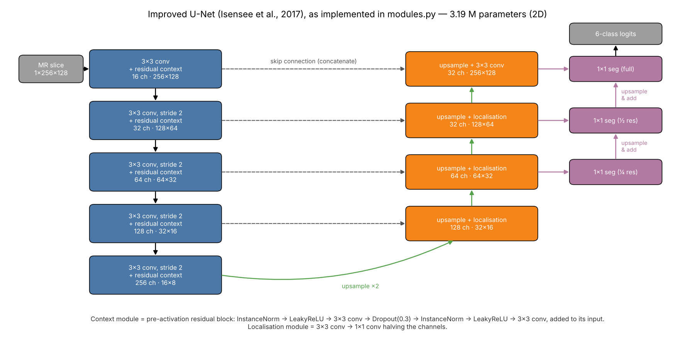
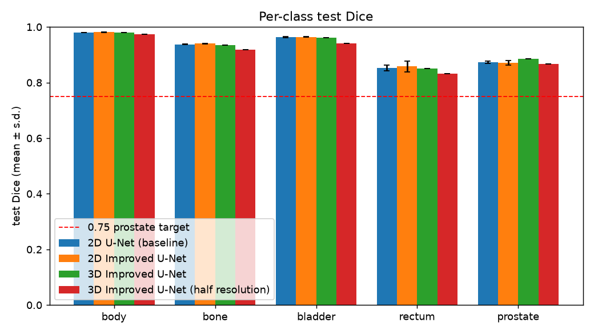
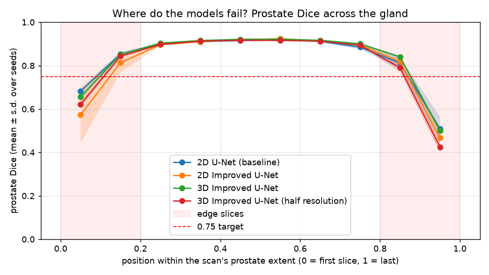
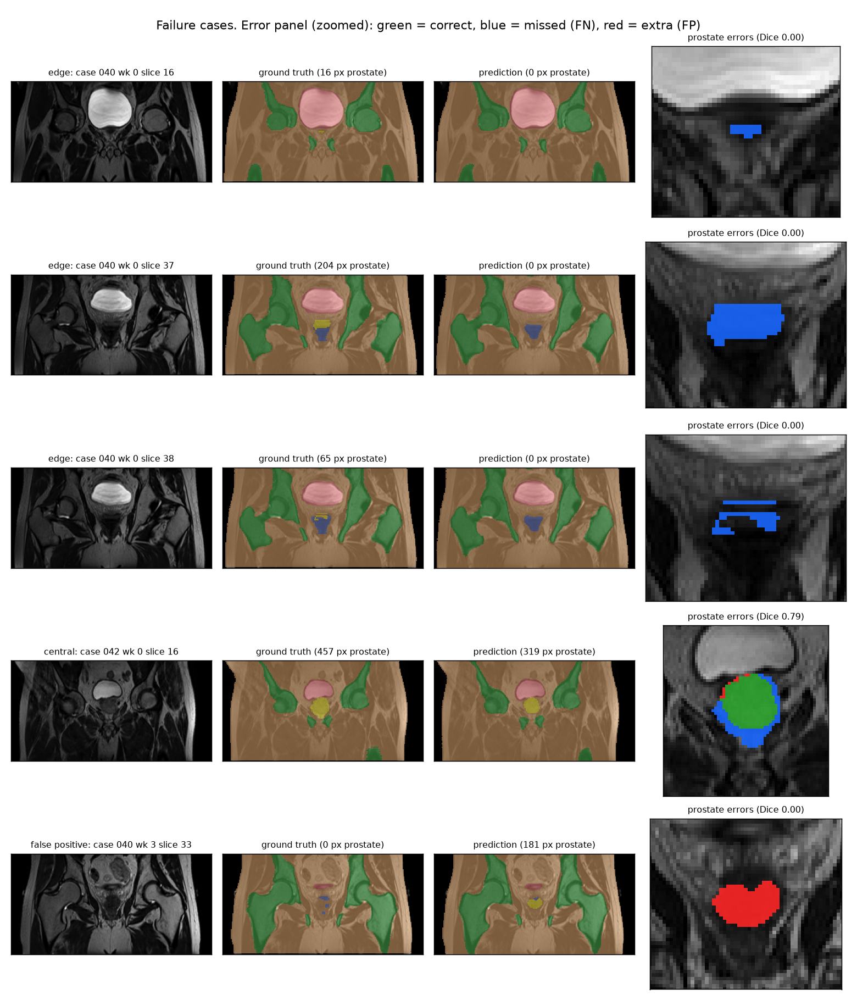

# Does More Spatial Context Fix Prostate Edge Slices? 2D U-Net vs 2D and 3D Improved U-Net on HipMRI

**Kelsen Ze Yang Gho · s4942544 · COMP3710 Pattern Recognition, 2026**
Segmentation project · 2D Improved U-Net (Normal) extended to the 3D Improved U-Net (Hard) · HipMRI prostate study

> **Draft status.** Every section that does not depend on experimental results is complete. Results are marked **`TBD`** and are filled in from `images/comparison.md` once the Rangpur runs finish. Before submission, `grep -n TBD README.md` must return nothing.

---

## Contents

1. [The problem and the algorithm](#1-the-problem-and-the-algorithm)
2. [Feasibility review (check-off, 20 October 2026)](#2-feasibility-review-check-off-20-october-2026)
3. [Data, pre-processing and splits](#3-data-pre-processing-and-splits)
4. [Models and training](#4-models-and-training)
5. [Evaluation protocol](#5-evaluation-protocol)
6. [Results: benchmarking against the baseline](#6-results-benchmarking-against-the-baseline)
7. [Failure-case autopsy](#7-failure-case-autopsy)
8. [Recommendation to the project manager](#8-recommendation-to-the-project-manager)
9. [Limitations](#9-limitations)
10. [Usage and reproduction](#10-usage-and-reproduction)
11. [Dependencies](#11-dependencies)
12. [Artificial Intelligence Usage Disclosure](#12-artificial-intelligence-usage-disclosure)
13. [References](#13-references)

---

## 1. The problem and the algorithm

**The problem.** Before external-beam radiotherapy for prostate cancer, a planner contours the prostate and the nearby organs at risk on the patient's MR scan, one slice at a time. The work is slow and varies between people. Errors in both directions are harmful: under-contouring leaves tumour untreated, while over-contouring irradiates the rectal wall and bladder. This project builds a **drafting assistant**. It segments every slice of a pelvic MR scan into six classes (background, body, bone, bladder, rectum and prostate) and proposes the contours for the planner to correct. The research question is the course's *spatial-context versus clinical-boundary-utility dilemma*. A good global Dice score can hide failures on the prostate's **edge slices**, where the gland first appears and disappears and its cross-section is tiny. So the question is whether more spatial context actually fixes those slices, or only smooths the easy central ones while costing more compute. Context comes in two forms here: multi-scale context in the 2D Improved U-Net, and true volumetric context in the 3D Improved U-Net.

**How it works.** Three models share one data pipeline, one loss and one evaluation:
- A **standard 2D U-Net** [1] is the baseline.
- The **2D Improved U-Net** [2] (figure below) is the multi-scale-context model. It is an encoder–decoder network:
  - The encoder downsamples with strided convolutions. At each of its five levels, a *residual context module* (two pre-activation convolutions with dropout, added back to its input) refines the features.
  - The decoder upsamples. At each level, it concatenates the matching encoder features through a skip connection and recombines them with a *localisation module*.
  - **Deep supervision** takes segmentation maps from three decoder resolutions, upsamples them and sums them. Coarse, context-rich levels therefore contribute directly to the output and receive gradient straight from the loss.
  - Instance normalisation and leaky ReLU keep training stable at small batch sizes.
- The **3D Improved U-Net** keeps the same design with every operation made volumetric. It sees neighbouring slices directly instead of one slice at a time.

All models are trained with cross-entropy plus soft Dice, so the prostate (0.43% of pixels) is not swamped by background. All are tested on the same held-out patients. On top of global Dice, the evaluation splits the prostate score by slice position (edge vs central slices) and measures boundary accuracy, leakage into the bladder and rectum, and false alarms on slices without a prostate.



*Figure 1. The Improved U-Net as implemented in `modules.py` (2D version shown; with a 256×128 input the bottleneck is 16×8).*

---

## 2. Feasibility review (check-off, 20 October 2026)

This is the one-page review presented at the compulsory check-off, reproduced unchanged.

> **Scope update after check-off.** The review planned the Normal-difficulty 2D Improved U-Net, with the 3D Improved U-Net as a stretch goal. The tutor raised no concerns, so the 2D work was completed as planned. The project was then extended to the 3D Improved U-Net (Hard), which is the stretch goal in the final paragraph. The 2D models stay in the report as the baseline (2D U-Net) and the multi-scale-context arm (2D Improved U-Net).

### 2.1 User need, scope and acceptance criteria

**User:** a radiotherapy planner who manually contours the prostate on pelvic MR before external-beam treatment.
**Prototype:** a 2D slice-wise annotation assistant that proposes six-class contours (background, body, bone, bladder, rectum, prostate) for the planner to review and correct. It is a drafting aid, never an autonomous contour.
**Open dilemma:** a good *global* Dice can hide failures on the prostate's **edge slices**, where the gland first appears and disappears in the scan and its cross-section is tiny. In this coronal data these are its front and back edges, the analogue of the base and apex on axial scans. There, under-contouring risks recurrence and over-contouring irradiates the rectum and bladder.

| # | Acceptance criterion (held-out, patient-level test split) |
|---|---|
| AC1 | Improved U-Net prostate Dice **≥ 0.75** (specification target). |
| AC2 | Prostate Dice reported **separately for edge slices** (outer 20% of each scan's prostate extent) vs central slices, for both models. The Improved U-Net is judged better only if its edge-slice Dice exceeds the baseline's by more than the seed-to-seed spread. |
| AC3 | **False-positive control:** on test slices with no prostate, ≤ 5% contain a spurious prostate prediction (> 20 px). |
| AC4 | **Resources:** ≤ 1 h training per model on one A100, ≤ 4 GB peak VRAM, ≤ 50 ms inference per slice (interactive use). |
| AC5 | **Reproducibility:** final numbers are mean ± s.d. over 3 random seeds with pinned dependency versions. |

### 2.2 Model choice and course concepts

* **Data:** HipMRI 2D `keras_slices_data`, 6 labels. The provided splits are kept, since the audit proved them patient-level.
* **Baseline:** standard 2D U-Net (Ronneberger et al., 2015). An encoder–decoder CNN with skip connections and batch norm.
* **Chosen model:** 2D **Improved U-Net** (Isensee et al., 2017). It adds:
  * residual *context modules* (residual learning from ResNet)
  * strided-convolution downsampling
  * **instance norm** (stable at small batch sizes)
  * **deep supervision**, which sums segmentation maps from three decoder scales
* **Loss:** cross-entropy + soft Dice. Dice weights every class equally, which counters the prostate's < 0.5% pixel share.
* **Why this tests the dilemma:** deep supervision injects coarse multi-scale context, and the hypothesis is that this helps the small, low-contrast edge slices. Both models see identical data, augmentation, optimiser and schedule.

### 2.3 Preliminary feasibility evidence

**Data audit (all 12,660 slices):**
* 31 / 4 / 3 patients in train / validate / test, with **zero patient overlap**.
* Every slice is paired with a mask.
* 99.5% of slices are 256×128. One scan is 256×144; it is centre-cropped, never resized, so labels are not interpolated.
* The prostate is **0.43% of pixels** and appears in only 36% of slices. It is present in **93% of mid-scan slices but only 2–7% near scan ends**, which is the edge-slice regime the dilemma targets.

**GPU smoke test (5 epochs each, full data, A100):**

| Model | Params | Peak VRAM | Time / epoch (steady) | Inference / slice | Test prostate Dice |
|---|---|---|---|---|---|
| Baseline U-Net | 7.76 M | 0.89 GB | 34 s | 2.6 ms | 0.865 |
| Improved U-Net | 3.19 M | 0.67 GB | 38 s | 6.0 ms | 0.862 |

Both models exceed AC1 after 5 epochs and are well inside AC4. Notably, they are **indistinguishable on global Dice**. This is direct evidence that the comparison must be stratified (AC2, AC3) rather than resting on a single headline number. Fewer parameters also did **not** mean faster inference (the Improved U-Net was 2.3× slower), which matters for the cost–benefit verdict.

### 2.4 Risks, budget and fallback

* **Small test cohort (3 patients, 9 scans)** gives high variance. *Mitigation:* 3 seeds, a per-patient breakdown and honest confidence statements.
* **No real difference between models.** This is a valid answer to the dilemma, not a failure. The stratified analysis will show *where*, if anywhere, the extra complexity helps.
* **Overfitting:** a train/validation loss gap is already visible (0.14 vs 0.37 at epoch 5). *Mitigation:* augmentation is in place, and the checkpoint is chosen on validation prostate Dice.
* **Cluster:** the `comp3710` partition rejected some `#SBATCH` options. *Mitigation:* minimal, tested Slurm scripts, with short smoke runs before long jobs.

**Compute budget:** 2 models × 3 seeds × 50 epochs × ~35 s ≈ **3 A100-hours**.
**Next experiment:** full 50-epoch runs of both models, then a `predict.py` evaluation stratified by slice position, and a failure autopsy on 3–5 edge-slice cases.
**Fallback:** if the Improved U-Net under-delivers, the Normal tier is already secured (AC1 met), and the comparison stands as a negative result.
**Stretch:** extend to the 3D Improved U-Net (Hard) to test whether true volumetric context fixes edge-slice errors.

---

## 3. Data, pre-processing and splits

### 3.1 Dataset

The HipMRI prostate study (CSIRO), read from `/home/groups/comp3710/HipMRI_Study_open` on Rangpur. Two forms are used:

| Form | Location | Content |
|---|---|---|
| 2D slices | `keras_slices_data/` | 12,660 image/mask Nifti pairs, mostly 256×128, already split into train / validate / test |
| 3D volumes | `semantic_MRs/`, `semantic_labels_only/` | 211 MR volumes with matching 6-label masks (`B006_Week0_LFOV.nii.gz` ↔ `B006_Week0_SEMANTIC.nii.gz`) |

The labels are 0 background, 1 body, 2 bone, 3 bladder, 4 rectum and 5 prostate. Each patient was scanned at several weeks of treatment. A patient's weeks are near-identical anatomy, which is why the split must be made by **patient**, never by slice or by scan.

### 3.2 Leakage audit and split justification

`data_audit.py` was run on every slice before any training. It parses the patient, week and slice index from each file name, pairs images with masks, and checks the provided split:

| Split | Slices | Scans | Patients | Slices with prostate |
|---|---|---|---|---|
| Train | 11,460 | 191 | 31 | TBD (audit output) |
| Validate | 660 | 11 | 4 | TBD |
| Test | 540 | 9 | 3 | TBD |

The three splits share **no patient**, and every image has exactly one mask. The provided split is therefore leakage-free at patient level and is used as it is. Keeping it, rather than re-splitting, also makes the results comparable with other work on the same folders.
- **Validation** (4 patients) is used for one thing only: choosing the checkpoint, by best validation prostate Dice.
- **Test** (3 patients, 540 slices) is evaluated **exactly once per trained model**, after training ends.

The test cohort is small, so every result is reported as mean ± s.d. over three seeds, together with a per-patient breakdown (Section 9).

**Same patients for the 3D model.** The 3D volumes use different patient identifiers from the 2D slices (`B006` vs `case_004`), and the dataset ships no lookup table. `map_2d_to_3d.py` recovers the link from content. It hashes every 2D ground-truth mask and compares it with every slice of every 3D label volume, along all three axes and under all eight flips/rotations. Masks are integer label maps, so an exact match is unambiguous. Each 2D scan is assigned to the volume most of its slices match. Then a single direction-and-offset rule (`3D index = ±2D index + offset`) is fitted, which places every slice, including any that repeat inside a volume. The 3D split is then inherited from the 2D split, so all three models are trained, validated and tested on exactly the same patients.

| Mapping check (from `map.slurm` output) | Result |
|---|---|
| 2D scans matched to a 3D volume | TBD / 211 |
| 2D slices placed at an exact 3D slice index | TBD % |
| Each 2D patient maps to exactly one 3D patient | TBD |
| 3D volumes not linked to any 2D scan (excluded) | TBD |
| Patient overlap between 3D train / validate / test | TBD (must be none) |

### 3.3 Pre-processing (2D)

| Step | What | Why |
|---|---|---|
| Geometry | Centre crop / zero-pad every slice to **256×128** | Matches 99.5% of slices. Cropping instead of resizing means mask labels are never interpolated and anatomical scale is preserved. |
| Intensity | **Per-slice z-score** normalisation | MR intensities are unitless and vary between scans (audit: maxima 582–738). |
| Labels | Class-index masks; `to_one_hot` gives the 6-channel encoding used by the Dice term | The specification asks for one-hot multi-channel masks. Indices are kept for cross-entropy. |
| Storage | Images cached as float16 and masks as uint8 in memory; loaded with a thread pool | The whole 2D set fits in RAM, so no file I/O happens during training. |

**Augmentation (training split only).** Each geometric transform is applied identically to image and mask, using bilinear sampling for the image and **nearest-neighbour** for the mask, so an augmented mask can only contain existing labels:
- random left–right flip (p = 0.5; pelvic anatomy is roughly symmetric)
- rotation of ±10°
- scaling of 0.9–1.1
- ±10% brightness and contrast jitter, mimicking coil and scanner variation

### 3.4 Pre-processing (3D)

TBD once `map.slurm` reports the volume sizes and voxel spacing. Planned design:
- Resample every volume to a common, downsampled grid, as the specification requires ("downsampled HipMRI 3D data"). Images use trilinear interpolation and masks nearest-neighbour.
- Apply per-volume z-score normalisation.
- Train on random patches or whole downsampled volumes, depending on VRAM.
- At evaluation time, upsample predictions back to native resolution and extract the 540 test slices using the 2D↔3D slice map. All three models are then scored on **identical pixels**.

---

## 4. Models and training

### 4.1 Models

| | 2D U-Net (baseline) | 2D Improved U-Net | 3D Improved U-Net |
|---|---|---|---|
| Reference | Ronneberger et al. [1] | Isensee et al. [2] | Isensee et al. [2] |
| Input | one 256×128 slice | one 256×128 slice | TBD 3D patch / volume |
| Downsampling | 2×2 max-pool | 3×3 stride-2 conv | 3×3×3 stride-2 conv |
| Upsampling | 2×2 transposed conv | nearest ×2 + 3×3 conv | nearest ×2 + 3×3×3 conv |
| Blocks | double 3×3 conv | residual context modules, dropout 0.3 | same, volumetric |
| Normalisation | batch norm | instance norm, leaky ReLU (0.01) | same |
| Output | final 1×1 conv | deep supervision (3 scales summed) | same |
| Parameters | 7.76 M | 3.19 M | TBD |

All models are defined in `modules.py`, which uses PyTorch only (no NumPy), as the specification requires.

### 4.2 Training setup (identical for both 2D models)

| Setting | Value |
|---|---|
| Loss | cross-entropy + soft Dice (foreground classes, equally weighted) |
| Optimiser | AdamW, learning rate 1e-3, weight decay 1e-5 |
| Schedule | cosine annealing over 50 epochs |
| Batch size | 16 |
| Precision | automatic mixed precision (fp16 autocast + gradient scaling) |
| Checkpoint selection | best **validation** prostate Dice |
| Seeds | 0, 1, 2 (each model trained three times) |
| Hardware | one NVIDIA A100 on Rangpur (`comp3710` partition) |

The 3D model's settings are TBD and will be reported here, with any differences from the 2D setup justified.

---

## 5. Evaluation protocol

All metrics are computed by `predict.py` on the held-out test split and aggregated over seeds by `compare.py`.

* **Dice and IoU per class**, accumulated over the whole test split (dataset-level). They are *not* averaged per slice: 64% of slices contain no prostate, and a slice where prediction and ground truth are both empty would otherwise count as a perfect 1.0.
* **Edge vs central slices (AC2).** For each scan, the prostate's extent is the range of slices that contain it. Slices in its outer 20% at either end are *edge* slices; the rest are *central*. Prostate Dice is also reported in 10 position bins across the extent.
* **Boundary F-score.** Precision and recall of predicted prostate boundary pixels within 2 px of the true boundary. This catches contours that overlap well but have ragged or shifted edges.
* **Clinical error measures:**
  * *under-contouring*: the % of true prostate pixels that were missed
  * *leakage*: the % of predicted prostate pixels that fall on true bladder or rectum
  * *false-alarm rate* (AC3): the % of prostate-free slices given a prostate prediction of more than 20 px
* **Resources (AC4):** parameter count, peak training VRAM, mean epoch time, and inference latency per slice (batch of 1, as in an interactive viewer). For the 3D model, latency is per volume.

The metric code was checked against 12 hand-built cases with known answers (for example, a prediction shifted by one pixel, an empty prediction, and leakage onto a rectum pixel). Its test Dice was also cross-checked against the value `train.py` computed independently.

---

## 6. Results: benchmarking against the baseline

All numbers are mean ± s.d. over 3 seeds on the held-out test split (3 patients, 9 scans, 540 slices).

### 6.1 Headline comparison

| Metric | 2D U-Net | 2D Improved U-Net | 3D Improved U-Net |
|---|---|---|---|
| Prostate Dice, all slices (AC1) | TBD | TBD | TBD |
| Prostate Dice, **edge** slices (AC2) | TBD | TBD | TBD |
| Prostate Dice, central slices | TBD | TBD | TBD |
| Prostate boundary F (2 px) | TBD | TBD | TBD |
| Under-contouring (% missed) | TBD | TBD | TBD |
| Leakage into bladder / rectum (%) | TBD | TBD | TBD |
| False-alarm rate on prostate-free slices (AC3) | TBD | TBD | TBD |
| Mean foreground Dice | TBD | TBD | TBD |

### 6.2 Per-class Dice and IoU

TBD (table from `images/comparison.md`).



### 6.3 Where along the prostate the models differ



TBD: interpretation of the position plot (does the gap open at the ends of the prostate?).

### 6.4 Resource profiling

| Resource | 2D U-Net | 2D Improved U-Net | 3D Improved U-Net |
|---|---|---|---|
| Parameters | 7.76 M | 3.19 M | TBD |
| Peak training VRAM | TBD | TBD | TBD |
| Training time (50 epochs) | TBD | TBD | TBD |
| Inference latency | TBD ms / slice | TBD ms / slice | TBD ms / volume (TBD ms / slice equivalent) |

### 6.5 Training curves and example outputs

TBD: `curves.png` for one seed of each model, and `examples.png` (input, ground truth and prediction for typical test slices).

---

## 7. Failure-case autopsy

`predict.py` selects failure cases automatically rather than by hand: the three worst-scoring edge slices, the worst central slice and the worst false alarm. Hand-picking would invite cherry-picking. Each panel shows the input, the ground truth, the prediction, and a zoomed error map (green = correct prostate, blue = missed, red = false positive).



| # | Case (patient / week / slice, position) | Dice | What went wrong | Root trigger | Fixed by 3D context? |
|---|---|---|---|---|---|
| 1 | TBD | TBD | TBD | TBD | TBD |
| 2 | TBD | TBD | TBD | TBD | TBD |
| 3 | TBD | TBD | TBD | TBD | TBD |
| 4 | TBD | TBD | TBD | TBD | TBD |
| 5 | TBD | TBD | TBD | TBD | TBD |

TBD: one paragraph per case diagnosing the failure mode.

---

## 8. Recommendation to the project manager

TBD. It will answer three questions, each backed by numbers from Sections 6 and 7:
1. Does multi-scale (2D Improved U-Net) or volumetric (3D Improved U-Net) context deliver a measurable gain on edge slices, beyond seed-to-seed variation?
2. Does that gain justify the extra GPU memory and time in an operational contouring pipeline?
3. Which anatomical cases remain unsuitable for automated drafting and must always be contoured by hand?

---

## 9. Limitations

* **Small test cohort.** With 3 test patients, a single difficult patient can move the mean. Seeds capture training variance but not patient-sampling variance. Per-patient Dice is reported for this reason, and the conclusions are worded accordingly.
* **Coronal slices.** The 2D data are coronal, so the "edge slices" are the prostate's anterior and posterior extremes rather than the base and apex seen on axial planning scans. The failure mechanism (a tiny, low-contrast cross-section) is the same, but the anatomy differs.
* **Labels from a single annotation.** No inter-observer contours are available, so it is unknown how much of the remaining error lies within normal human disagreement.
* **Week-to-week correlation.** The weeks of one patient are kept together in one split, but they are not independent samples. The effective training set is closer to 31 patients than to 191 scans.

---

## 10. Usage and reproduction

### 10.1 Repository layout

```
recognition/ImprovedUNet_HipMRI_s4942544/
├── README.md               this report
├── modules.py              BaselineUNet, ImprovedUNet, DiceCELoss  (PyTorch only)
├── dataset.py              HipMRI loader: pairing, crop/pad, normalisation, augmentation, dataloaders
├── train.py                training, validation, single test evaluation, curves, resource profile
├── predict.py              loads best.pt, runs inference, stratified evaluation and figures
├── compare.py              aggregates seeds into README tables and comparison figures
├── utils.py                metrics, latency measurement, seeding, plotting
├── data_audit.py           pre-training leakage / pairing / class-balance audit
├── map_2d_to_3d.py         links 2D scans to 3D volumes; writes the 3D patient-level split
├── *.slurm                 Rangpur batch scripts (smoke test, training, evaluation, mapping)
├── feasibility_review.md   the check-off document (also Section 2)
├── requirements.txt        pinned dependency versions
└── images/                 figures used in this README
```

No data, checkpoints or logs are committed (see `.gitignore`).

### 10.2 Commands (Rangpur)

All Slurm scripts request `--partition=comp3710 --account=comp3710` and one GPU. Run them from this folder.

```bash
# 0. environment
conda activate torch                      # versions in requirements.txt

# 1. audit the data (CPU, ~5 min)
python data_audit.py --out audit_out

# 2. train both 2D models, three seeds each (~35-40 min per run on an A100)
for model in baseline improved; do
  for seed in 0 1 2; do
    sbatch --export=ALL,MODEL=$model,SEED=$seed train.slurm
  done
done
# -> runs/<model>_s<seed>/{best.pt, history.json, curves.png, results.json}

# 3. evaluate every run on the test split and build the comparison tables/figures
sbatch eval.slurm
# -> eval/<run>/{eval.json, examples.png, failure_cases.png, dice_by_position.png}
# -> images/{comparison.md, comparison_position.png, comparison_per_class.png}

# 4. link 2D scans to 3D volumes (needed for the 3D model's split)
sbatch map.slurm
# -> mapping_out/{volumes_3d.json, mapping_2d_3d.json, splits_3d.json}
```

You can also evaluate a single checkpoint directly:

```bash
python predict.py --model improved --ckpt runs/improved_s0/best.pt --out eval/improved_s0
```

`predict.py` prints per-class Dice/IoU, the edge/central breakdown, clinical error measures and latency. It also saves the example and failure-case figures.

### 10.3 Reproducibility

* Every random number generator (Python, NumPy, PyTorch CPU and CUDA) is seeded from `--seed`. Results are reported over seeds 0, 1 and 2 rather than one lucky run.
* The data split is fixed (the provided patient-level folders), and the 3D split is derived from it deterministically.
* Deterministic GPU kernels are not enforced (`torch.use_deterministic_algorithms` is off, for speed), so re-running a seed can differ slightly, typically in the third decimal place. The seed-to-seed spread is reported so that differences of that size are not over-interpreted.
* Exact package versions are pinned in `requirements.txt` (Section 11).

---

## 11. Dependencies

Exact versions as installed in the Rangpur `torch` conda environment used for every run (`requirements.txt`):

| Package | Version | Used for |
|---|---|---|
| Python | TBD | |
| PyTorch | TBD (CUDA TBD) | models, training, inference |
| NumPy | TBD | data loading and evaluation only (not in `modules.py`) |
| nibabel | TBD | reading Nifti (`.nii.gz`) files |
| matplotlib | TBD | all figures |

Hardware: NVIDIA A100 (Rangpur `comp3710` partition).

---

## 12. Artificial Intelligence Usage Disclosure

**Tools used.** Anthropic's Claude (the Claude app, with Claude Code agent capabilities) was used throughout the project as a programming and writing assistant. TBD: list any other tools used (for example, GitHub Copilot), or state that none were.

**What AI assisted with.**
* Reading the assessment specification and planning the project scope and timeline, including the decision to start at Normal difficulty and extend to Hard.
* Drafting the code in this folder: the data audit, data loader, both 2D architectures, the loss, the training and evaluation scripts, the 2D↔3D mapping script and the Slurm scripts. I then ran, reviewed and corrected this code.
* Debugging. Examples: the mask-file naming bug found by the audit (`seg_` vs `case_` prefixes), git push rejection, and Slurm submission errors.
* Drafting the structure and wording of this README and the feasibility review.

**How the AI-assisted work was audited and verified.**
* **Real-data checks before training.** The data audit was run on all 12,660 real slices. It confirmed pairing, shapes, label values and zero patient overlap. Its first run crashed on the real data because the AI-written file-name parser did not recognise the `seg_` prefix of the mask files. The parser was fixed, and the audit now fails loudly if any image is left without a mask.
* **Unit tests with known answers.**
  * The data loader was tested on synthetic data (14 checks: shapes, crop/pad, label safety under augmentation).
  * The evaluation metrics were tested against 12 hand-constructed cases with known answers.
  * The 2D↔3D mapping was tested on deliberately awkward synthetic volumes (transposed, reversed slice order, padded, a duplicated slice, a spare volume). It recovered every scan and every slice index.
* **Independent cross-checks.** The test Dice from `predict.py` was checked against the value `train.py` computed with separate code. Parameter counts were checked against the architecture.
* **Smoke tests on Rangpur.** Short 5-epoch runs of both models confirmed the full pipeline end to end before long jobs were launched.
* **My own corrections.** Not every AI suggestion was right. For example, the AI initially blamed a Slurm `PartitionConfig` error on `--cpus-per-task`. I found that the real cause was the missing `#SBATCH --account=comp3710` line and corrected the scripts.
* **Progressive development.** The work was committed in small, reviewed steps (see the commit log), not as one generated code dump.
* TBD (in your own words): how you read through and understood each file, and anything you changed yourself.

I take full responsibility for every line of code, every formula and every number in this submission.

---

## 13. References

[1] O. Ronneberger, P. Fischer and T. Brox, "U-Net: Convolutional networks for biomedical image segmentation," in *Proc. MICCAI*, 2015, pp. 234–241.

[2] F. Isensee, P. Kickingereder, W. Wick, M. Bendszus and K. H. Maier-Hein, "Brain tumor segmentation and radiomics survival prediction: Contribution to the BRATS 2017 challenge," in *Brainlesion: Glioma, Multiple Sclerosis, Stroke and TBI Models*, 2018, pp. 287–297. arXiv:1802.10508.

[3] Ö. Çiçek, A. Abdulkadir, S. S. Lienkamp, T. Brox and O. Ronneberger, "3D U-Net: Learning dense volumetric segmentation from sparse annotation," in *Proc. MICCAI*, 2016, pp. 424–432.

[4] K. He, X. Zhang, S. Ren and J. Sun, "Identity mappings in deep residual networks," in *Proc. ECCV*, 2016, pp. 630–645. (Pre-activation residual blocks used in the context modules.)

[5] D. Ulyanov, A. Vedaldi and V. Lempitsky, "Instance normalization: The missing ingredient for fast stylization," arXiv:1607.08022, 2016.

[6] F. Milletari, N. Navab and S.-A. Ahmadi, "V-Net: Fully convolutional neural networks for volumetric medical image segmentation," in *Proc. 3DV*, 2016, pp. 565–571. (Soft Dice loss.)

[7] CSIRO, *HipMRI prostate study* (open release, provided by the COMP3710 teaching team on Rangpur).
