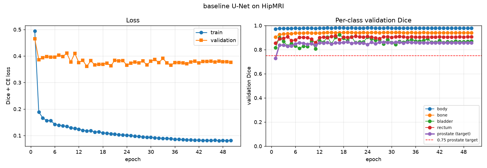
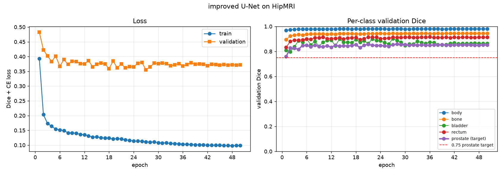
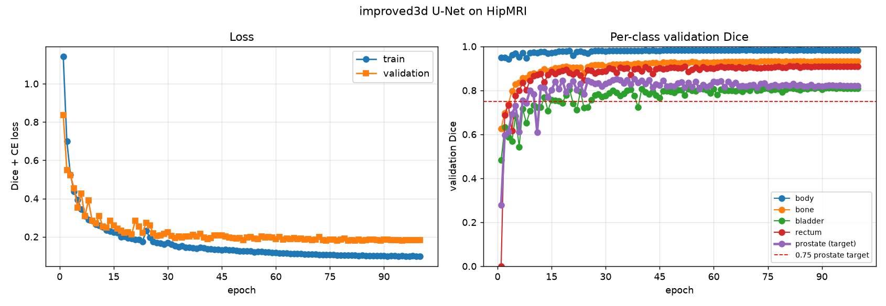
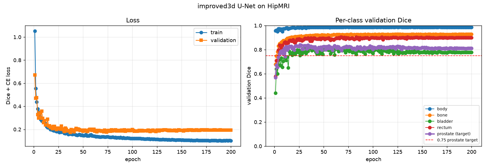
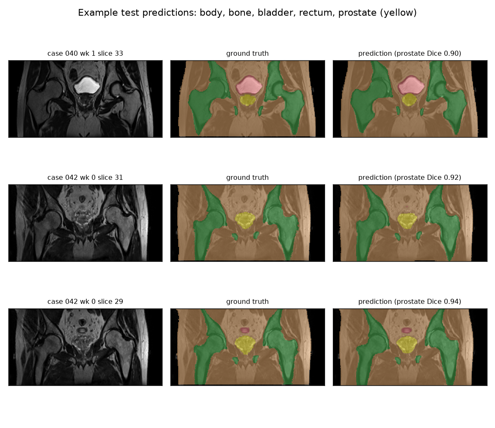
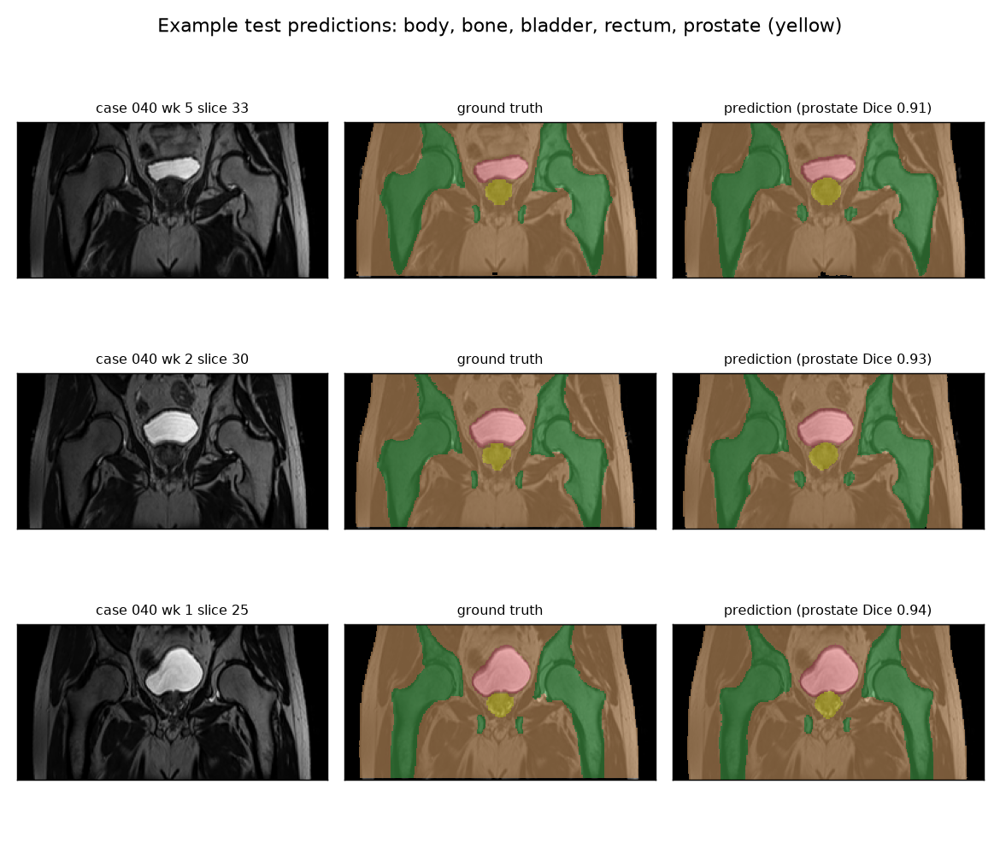
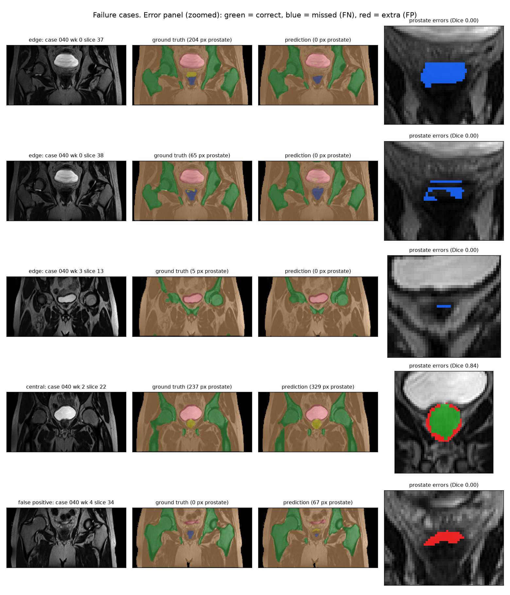

# Does More Spatial Context Fix Prostate Edge Slices? 2D U-Net vs 2D and 3D Improved U-Net on HipMRI

**Kelsen Ze Yang Gho · s4942544 · COMP3710 Pattern Recognition, 2026**
Segmentation project · 2D Improved U-Net (Normal) extended to the 3D Improved U-Net (Hard) · HipMRI prostate study

> **Status:** complete for all models. The 3D results marked † are from one seed and are being updated to 3-seed means.

---

## Contents

1. [The problem and the algorithm](#1-the-problem-and-the-algorithm)
2. [Feasibility review (check-off, 20 October 2026)](#2-feasibility-review-check-off-20-october-2026)
3. [Data, pre-processing and splits](#3-data-pre-processing-and-splits)
4. [Models and training](#4-models-and-training)
5. [Evaluation protocol](#5-evaluation-protocol)
6. [Results: benchmarking against the baseline](#6-results-benchmarking-against-the-baseline)
7. [Failure-case autopsy](#7-failure-case-autopsy)
8. [Recommendation to the project manager](#8-recommendation-to-the-project-manager)
9. [Limitations](#9-limitations)
10. [Usage and reproduction](#10-usage-and-reproduction)
11. [Dependencies](#11-dependencies)
12. [Artificial Intelligence Usage Disclosure](#12-artificial-intelligence-usage-disclosure)
13. [References](#13-references)

---

## 1. The problem and the algorithm

**The problem.** Before external-beam radiotherapy for prostate cancer, a planner contours the prostate and the nearby organs at risk on the patient's MR scan, one slice at a time. The work is slow and varies between people. Errors in both directions are harmful: under-contouring leaves tumour untreated, while over-contouring irradiates the rectal wall and bladder. This project builds a **drafting assistant**. It segments every slice of a pelvic MR scan into six classes (background, body, bone, bladder, rectum and prostate) and proposes the contours for the planner to correct. The research question is the course's *spatial-context versus clinical-boundary-utility dilemma*. A good global Dice score can hide failures on the prostate's **edge slices**, where the gland first appears and disappears and its cross-section is tiny. So the question is whether more spatial context actually fixes those slices, or only smooths the easy central ones while costing more compute. Context comes in two forms here: multi-scale context in the 2D Improved U-Net, and true volumetric context in the 3D Improved U-Net.

**How it works.** Three models share one data pipeline, one loss and one evaluation:
- A **standard 2D U-Net** [1] is the baseline.
- The **2D Improved U-Net** [2] (figure below) is the multi-scale-context model. It is an encoder–decoder network:
  - The encoder downsamples with strided convolutions. At each of its five levels, a *residual context module* (two pre-activation convolutions with dropout, added back to its input) refines the features.
  - The decoder upsamples. At each level, it concatenates the matching encoder features through a skip connection and recombines them with a *localisation module*.
  - **Deep supervision** takes segmentation maps from three decoder resolutions, upsamples them and sums them. Coarse, context-rich levels therefore contribute directly to the output and receive gradient straight from the loss.
  - Instance normalisation and leaky ReLU keep training stable at small batch sizes.
- The **3D Improved U-Net** keeps the same design with every operation made volumetric. It sees neighbouring slices directly instead of one slice at a time.

All models are trained with cross-entropy plus soft Dice, so the prostate (0.43% of pixels) is not swamped by background. All are tested on the same held-out patients. On top of global Dice, the evaluation splits the prostate score by slice position (edge vs central slices) and measures boundary accuracy, leakage into the bladder and rectum, and false alarms on slices without a prostate.


*Figure 1. The Improved U-Net as implemented in `modules.py` (2D version shown; with a 256×128 input the bottleneck is 16×8).*

---

## 2. Feasibility review (check-off, 20 October 2026)

This is the one-page review presented at the compulsory check-off, reproduced unchanged.

> **Scope update after check-off.** The review planned the Normal-difficulty 2D Improved U-Net, with the 3D Improved U-Net as a stretch goal. The tutor raised no concerns, so the 2D work was completed as planned. The project was then extended to the 3D Improved U-Net (Hard), which is the stretch goal in the final paragraph. The 2D models stay in the report as the baseline (2D U-Net) and the multi-scale-context arm (2D Improved U-Net).

### 2.1 User need, scope and acceptance criteria

**User:** a radiotherapy planner who manually contours the prostate on pelvic MR before external-beam treatment.
**Prototype:** a 2D slice-wise annotation assistant that proposes six-class contours (background, body, bone, bladder, rectum, prostate) for the planner to review and correct. It is a drafting aid, never an autonomous contour.
**Open dilemma:** a good *global* Dice can hide failures on the prostate's **edge slices**, where the gland first appears and disappears in the scan and its cross-section is tiny. In this coronal data these are its front and back edges, the analogue of the base and apex on axial scans. There, under-contouring risks recurrence and over-contouring irradiates the rectum and bladder.

| # | Acceptance criterion (held-out, patient-level test split) |
|---|---|
| AC1 | Improved U-Net prostate Dice **≥ 0.75** (specification target). |
| AC2 | Prostate Dice reported **separately for edge slices** (outer 20% of each scan's prostate extent) vs central slices, for both models. The Improved U-Net is judged better only if its edge-slice Dice exceeds the baseline's by more than the seed-to-seed spread. |
| AC3 | **False-positive control:** on test slices with no prostate, ≤ 5% contain a spurious prostate prediction (> 20 px). |
| AC4 | **Resources:** ≤ 1 h training per model on one A100, ≤ 4 GB peak VRAM, ≤ 50 ms inference per slice (interactive use). |
| AC5 | **Reproducibility:** final numbers are mean ± s.d. over 3 random seeds with pinned dependency versions. |

### 2.2 Model choice and course concepts

* **Data:** HipMRI 2D `keras_slices_data`, 6 labels. The provided splits are kept, since the audit proved them patient-level.
* **Baseline:** standard 2D U-Net (Ronneberger et al., 2015). An encoder–decoder CNN with skip connections and batch norm.
* **Chosen model:** 2D **Improved U-Net** (Isensee et al., 2017). It adds:
  * residual *context modules* (residual learning from ResNet)
  * strided-convolution downsampling
  * **instance norm** (stable at small batch sizes)
  * **deep supervision**, which sums segmentation maps from three decoder scales
* **Loss:** cross-entropy + soft Dice. Dice weights every class equally, which counters the prostate's < 0.5% pixel share.
* **Why this tests the dilemma:** deep supervision injects coarse multi-scale context, and the hypothesis is that this helps the small, low-contrast edge slices. Both models see identical data, augmentation, optimiser and schedule.

### 2.3 Preliminary feasibility evidence

**Data audit (all 12,660 slices):**
* 31 / 4 / 3 patients in train / validate / test, with **zero patient overlap**.
* Every slice is paired with a mask.
* 99.5% of slices are 256×128. One scan is 256×144; it is centre-cropped, never resized, so labels are not interpolated.
* The prostate is **0.43% of pixels** and appears in only 36% of slices. It is present in **93% of mid-scan slices but only 2–7% near scan ends**, which is the edge-slice regime the dilemma targets.

**GPU smoke test (5 epochs each, full data, A100):**

| Model | Params | Peak VRAM | Time / epoch (steady) | Inference / slice | Test prostate Dice |
|---|---|---|---|---|---|
| Baseline U-Net | 7.76 M | 0.89 GB | 34 s | 2.6 ms | 0.865 |
| Improved U-Net | 3.19 M | 0.67 GB | 38 s | 6.0 ms | 0.862 |

Both models exceed AC1 after 5 epochs and are well inside AC4. Notably, they are **indistinguishable on global Dice**. This is direct evidence that the comparison must be stratified (AC2, AC3) rather than resting on a single headline number. Fewer parameters also did **not** mean faster inference (the Improved U-Net was 2.3× slower), which matters for the cost–benefit verdict.

### 2.4 Risks, budget and fallback

* **Small test cohort (3 patients, 9 scans)** gives high variance. *Mitigation:* 3 seeds, a per-patient breakdown and honest confidence statements.
* **No real difference between models.** This is a valid answer to the dilemma, not a failure. The stratified analysis will show *where*, if anywhere, the extra complexity helps.
* **Overfitting:** a train/validation loss gap is already visible (0.14 vs 0.37 at epoch 5). *Mitigation:* augmentation is in place, and the checkpoint is chosen on validation prostate Dice.
* **Cluster:** the `comp3710` partition rejected some `#SBATCH` options. *Mitigation:* minimal, tested Slurm scripts, with short smoke runs before long jobs.

**Compute budget:** 2 models × 3 seeds × 50 epochs × ~35 s ≈ **3 A100-hours**.
**Next experiment:** full 50-epoch runs of both models, then a `predict.py` evaluation stratified by slice position, and a failure autopsy on 3–5 edge-slice cases.
**Fallback:** if the Improved U-Net under-delivers, the Normal tier is already secured (AC1 met), and the comparison stands as a negative result.
**Stretch:** extend to the 3D Improved U-Net (Hard) to test whether true volumetric context fixes edge-slice errors.

---

## 3. Data, pre-processing and splits

### 3.1 Dataset

The HipMRI prostate study (CSIRO), read from `/home/groups/comp3710/HipMRI_Study_open` on Rangpur. Two forms are used:

| Form | Location | Content |
|---|---|---|
| 2D slices | `keras_slices_data/` | 12,660 image/mask Nifti pairs, mostly 256×128, already split into train / validate / test |
| 3D volumes | `semantic_MRs/`, `semantic_labels_only/` | 211 MR volumes with matching 6-label masks (`B006_Week0_LFOV.nii.gz` ↔ `B006_Week0_SEMANTIC.nii.gz`) |

The labels are 0 background, 1 body, 2 bone, 3 bladder, 4 rectum and 5 prostate. Each patient was scanned at several weeks of treatment. A patient's weeks are near-identical anatomy, which is why the split must be made by **patient**, never by slice or by scan.

### 3.2 Leakage audit and split justification

`data_audit.py` was run on every slice before any training. It parses the patient, week and slice index from each file name, pairs images with masks, and checks the provided split:

| Split | Slices | Scans | Patients | Slices with prostate |
|---|---|---|---|---|
| Train | 11,460 | 191 | 31 | 4,152 (36.2%) |
| Validate | 660 | 11 | 4 | 254 (38.5%) |
| Test | 540 | 9 | 3 | 195 (36.1%) |

The three splits share **no patient**, and every image has exactly one mask. The provided split is therefore leakage-free at patient level and is used as it is. Keeping it, rather than re-splitting, also makes the results comparable with other work on the same folders.
- **Validation** (4 patients) is used for one thing only: choosing the checkpoint, by best validation prostate Dice.
- **Test** (3 patients, 540 slices) is evaluated **exactly once per trained model**, after training ends.

The test cohort is small, so every result is reported as mean ± s.d. over three seeds, together with a per-patient breakdown (Section 9).

**Same patients for the 3D model.** The 3D volumes use different patient identifiers from the 2D slices (`B006` vs `case_004`), and the dataset ships no lookup table. `map_2d_to_3d.py` recovers the link from content. It hashes every 2D ground-truth mask and compares it with every slice of every 3D label volume, along all three axes and under all eight flips/rotations. Masks are integer label maps, so an exact match is unambiguous. Each 2D scan is assigned to the volume most of its slices match. Then a single direction-and-offset rule (`3D index = ±2D index + offset`) is fitted, which places every slice, including any that repeat inside a volume. The 3D split is then inherited from the 2D split, so all three models are trained, validated and tested on exactly the same patients.

| Mapping check (from `map.slurm` output) | Result |
|---|---|
| 2D scans matched to a 3D volume | 211 / 211 |
| 2D slices placed at an exact 3D slice index | 100% (all 12,660) |
| Each 2D patient maps to exactly one 3D patient | yes (38 patients) |
| 3D volumes not linked to any 2D scan (excluded) | 0 |
| Patient overlap between 3D train / validate / test | none (191 / 11 / 9 volumes; 31 / 4 / 3 patients) |

### 3.3 Pre-processing (2D)

| Step | What | Why |
|---|---|---|
| Geometry | Centre crop / zero-pad every slice to **256×128** | Matches 99.5% of slices. Cropping instead of resizing means mask labels are never interpolated and anatomical scale is preserved. |
| Intensity | **Per-slice z-score** normalisation | MR intensities are unitless and vary between scans (audit: maxima 582–738). |
| Labels | Class-index masks; `to_one_hot` gives the 6-channel encoding used by the Dice term | The specification asks for one-hot multi-channel masks. Indices are kept for cross-entropy. |
| Storage | Images cached as float16 and masks as uint8 in memory; loaded with a thread pool | The whole 2D set fits in RAM, so no file I/O happens during training. |

**Augmentation (training split only).** Each geometric transform is applied identically to image and mask, using bilinear sampling for the image and **nearest-neighbour** for the mask, so an augmented mask can only contain existing labels:
- random left–right flip (p = 0.5; pelvic anatomy is roughly symmetric)
- rotation of ±10°
- scaling of 0.9–1.1
- ±10% brightness and contrast jitter, mimicking coil and scanner variation

### 3.4 Pre-processing (3D)

The mapping run established the geometry. Every volume is 256 × 256 × 128 voxels, except one that is 256 × 256 × 144. Voxels are about 1.6 × 1.6 × 1.56 mm (the in-plane spacing varies slightly, 1.56–1.76 mm). All volumes are stored in LPS order: axis 0 left–right, axis 1 anterior–posterior, axis 2 superior–inferior. Each 2D scan is exactly 60 consecutive coronal slices (along axis 1) of its volume, flipped up–down.

| Step | What | Why |
|---|---|---|
| Geometry | Centre-crop the anterior–posterior axis to 128 slices (voxels 64–191), and keep the full left–right (256) and superior–inferior (128) extent, giving a **256 × 128 × 128** input | Fits A100 memory at full resolution. Every 2D slice lies within voxels 64–191, so no test slice is lost. The loader verifies that no prostate voxel is ever cropped away. The one 144-deep volume is centre-cropped to 128 exactly as its 2D slices are. |
| Resolution | **Full** (1×), and a second run at **half** resolution (2×2×2 average-pooled image, centre-voxel mask → 128 × 64 × 64) | The specification calls for downsampled 3D data. Running both tells us how much accuracy the downsampling itself costs, which is a direct input to the compute trade-off. |
| Intensity | Per-volume z-score | Same rationale as the per-slice normalisation in 2D. A whole volume is the natural unit in 3D. |
| Augmentation | Left–right flip, ±10° rotation in the axial plane, 0.9–1.1 scaling, ±10% brightness/contrast. Applied **batched on the GPU**, mask resampled nearest-neighbour | The same augmentations as 2D, made volumetric. A Slurm job has a single CPU core, which is far too slow for 3D resampling. |

**Evaluation on identical pixels.** `predict.py` predicts each of the 9 test volumes. For the half-resolution run, it upsamples the logits trilinearly back to full resolution. It then undoes the crop and cuts out exactly the 540 2D test slices using the slice map. As a built-in alignment check, the same cut is applied to the 3D ground truth, and the result must equal the 2D ground-truth masks slice for slice. For the half-resolution run, `predict.py` also reports the *resolution ceiling*: the prostate Dice obtained by simply down- and up-sampling the ground truth itself. No model at that resolution can exceed it.

---

## 4. Models and training

### 4.1 Models

| | 2D U-Net (baseline) | 2D Improved U-Net | 3D Improved U-Net |
|---|---|---|---|
| Reference | Ronneberger et al. [1] | Isensee et al. [2] | Isensee et al. [2] |
| Input | one 256×128 slice | one 256×128 slice | one 256×128×128 volume (or 128×64×64 at half resolution) |
| Downsampling | 2×2 max-pool | 3×3 stride-2 conv | 3×3×3 stride-2 conv |
| Upsampling | 2×2 transposed conv | nearest ×2 + 3×3 conv | nearest ×2 + 3×3×3 conv |
| Blocks | double 3×3 conv | residual context modules, dropout 0.3 | same, volumetric |
| Normalisation | batch norm | instance norm, leaky ReLU (0.01) | same |
| Output | final 1×1 conv | deep supervision (3 scales summed) | same |
| Parameters | 7.76 M | 3.19 M | 9.46 M |

All models are defined in `modules.py`, which uses PyTorch only (no NumPy), as the specification requires.

### 4.2 Training setup (identical for both 2D models)

| Setting | Value |
|---|---|
| Loss | cross-entropy + soft Dice (foreground classes, equally weighted) |
| Optimiser | AdamW, learning rate 1e-3, weight decay 1e-5 |
| Schedule | cosine annealing over 50 epochs |
| Batch size | 16 |
| Precision | automatic mixed precision (fp16 autocast + gradient scaling) |
| Checkpoint selection | best **validation** prostate Dice |
| Seeds | 0, 1, 2 (each model trained three times) |
| Hardware | one NVIDIA A100 on Rangpur (`comp3710` partition) |

The 3D model uses the same loss, optimiser, learning rate, weight decay, cosine schedule, mixed precision and checkpoint rule. The differences are forced by memory and data size:
- **Batch size 2 volumes.** One volume holds 128 slices' worth of voxels.
- **100 epochs at full resolution and 200 at half resolution.** An epoch has only 95 steps, compared with 716 for 2D.
- **A training time budget of 200 minutes.** If it is reached, training stops early and the best checkpoint is still evaluated. The number of epochs actually completed is recorded in `results.json`.
- **Seeds.** 0, 1 and 2 for both resolutions, as for 2D (the README currently shows seed 0, marked †).

---

## 5. Evaluation protocol

All metrics are computed by `predict.py` on the held-out test split and aggregated over seeds by `compare.py`.

* **Dice and IoU per class**, accumulated over the whole test split (dataset-level). They are *not* averaged per slice: 64% of slices contain no prostate, and a slice where prediction and ground truth are both empty would otherwise count as a perfect 1.0.
* **Edge vs central slices (AC2).** For each scan, the prostate's extent is the range of slices that contain it. Slices in its outer 20% at either end are *edge* slices; the rest are *central*. Prostate Dice is also reported in 10 position bins across the extent.
* **Boundary F-score.** Precision and recall of predicted prostate boundary pixels within 2 px of the true boundary. This catches contours that overlap well but have ragged or shifted edges.
* **Clinical error measures:**
  * *under-contouring*: the % of true prostate pixels that were missed
  * *leakage*: the % of predicted prostate pixels that fall on true bladder or rectum
  * *false-alarm rate* (AC3): the % of prostate-free slices given a prostate prediction of more than 20 px
* **Resources (AC4):** parameter count, peak training VRAM, mean epoch time, and inference latency per slice (batch of 1, as in an interactive viewer). For the 3D model, latency is per volume.

The metric code was checked against 12 hand-built cases with known answers (for example, a prediction shifted by one pixel, an empty prediction, and leakage onto a rectum pixel). Its test Dice was also cross-checked against the value `train.py` computed independently.

---

## 6. Results: benchmarking against the baseline

All models are scored on the same held-out test split: 3 patients, 9 scans, 540 slices, never seen during training or model selection. The 3D model is scored on exactly the same 540 slices, cut back out of its volumetric predictions (Section 3.4). The alignment check found 0 mismatched slices. The tables are generated by `compare.py` (`images/comparison.md`).
- **2D models:** mean ± sample standard deviation over **3 seeds** each.
- **3D models:** numbers marked **†** are a single seed (seed 0). Seeds 1–2 are running, and these cells will be replaced by 3-seed means.

### 6.1 Headline comparison and acceptance criteria

| Metric | 2D U-Net (baseline) | 2D Improved U-Net | **3D Improved U-Net** | 3D Improved U-Net, half resolution |
|---|---|---|---|---|
| Prostate Dice, all slices (AC1) | 0.873 ± 0.003 | 0.871 ± 0.008 | **0.885** † | 0.867 † |
| Prostate IoU | 0.775 ± 0.005 | 0.771 ± 0.013 | **0.794** † | 0.765 † |
| Prostate Dice, central slices | 0.906 ± 0.001 | 0.909 ± 0.004 | **0.918** † | 0.904 † |
| Prostate Dice, **edge** slices (AC2) | 0.741 ± 0.016 | 0.713 ± 0.028 | **0.753** † | 0.702 † |
| Prostate boundary F-score (2 px) | 0.920 ± 0.006 | 0.915 ± 0.012 | **0.940** † | 0.925 † |
| Under-contouring (% of true prostate missed) | 12.2 ± 2.5 | 12.7 ± 0.7 | **8.3** † | 11.0 † |
| Leakage into bladder (% of prostate area) | 0.92 ± 0.38 | 1.17 ± 0.31 | 0.83 † | **0.50** † |
| Leakage into rectum (% of prostate area) | 0.26 ± 0.34 | 0.16 ± 0.04 | **0.01** † | **0.00** † |
| False-alarm rate on prostate-free slices (AC3) | 0.6 ± 0.8 % | 0.6 ± 0.3 % | 0.6 % † | 0.6 % † |
| Whole slices with the prostate missed entirely | 13.3 ± 2.3 | 17.7 ± 3.1 | **9** † | 14 † |
| Mean foreground Dice (5 classes) | 0.921 | 0.923 | 0.922 † | 0.906 † |

| Criterion | 2D U-Net | 2D Improved U-Net | 3D Improved U-Net |
|---|---|---|---|
| AC1: prostate Dice ≥ 0.75 (Hard target for 3D: ≥ 0.70) | ✅ 0.873 | ✅ 0.871 | ✅ 0.885 † |
| AC2: beats the 2D baseline on edge slices by more than the seed spread | n/a | ❌ 0.028 *worse* | ⚠️ +0.012 †, within the baseline's spread (± 0.016) |
| AC3: ≤ 5% false alarms on prostate-free slices | ✅ 0.6% | ✅ 0.6% | ✅ 0.6% † |
| AC4: ≤ 1 h training, ≤ 4 GB VRAM, ≤ 50 ms per slice | ✅ | ✅ | ⚠️ 7.7 GB VRAM (time and latency ✅) |
| AC5: 3 seeds, pinned versions | ✅ | ✅ | † 1 seed so far |

**Reading the table.**

- **Every model passes its target.** On global Dice, the two 2D models are indistinguishable (0.873 vs 0.871).
- **Multi-scale context did not help.** The 2D Improved U-Net is *worse* than the baseline on edge slices (0.713 vs 0.741, about 1.5 standard errors with three seeds) and twice as unstable across seeds. So AC2 fails for it.
- **Volumetric context helps, but modestly.** At full resolution, the 3D Improved U-Net is the best model on every prostate measure:
  - It improves central and edge slices by the same amount, about +0.012 each, so it does not just "smooth easy central slices".
  - It cuts missed prostate from 12% to 8%.
  - It cuts whole-slice omissions by a third, from 13 to 9.
  - It nearly eliminates leakage into the rectum (0.01%).
  - Its edge-slice gain is still within the baseline's seed spread, so the 3-seed runs will decide whether that particular gain is real.
- **Resolution matters more than context at the edges.** The half-resolution 3D model has the same architecture and the same 3D context, yet it is the *worst* model on edge slices (0.702). Down- and up-sampling the ground truth alone already caps its prostate Dice at **0.925**, before any model error.
- **All models err in the same direction.** Each misses far more prostate (8–13%) than it leaks into the bladder or rectum (≤ 1.2%). The errors fall on the recurrence-risk side of the dilemma, not the toxicity side.

### 6.2 Per-class Dice and IoU

| Class | 2D U-Net Dice / IoU | 2D Improved U-Net Dice / IoU | 3D Improved U-Net Dice / IoU † | 3D half-resolution Dice / IoU † |
|---|---|---|---|---|
| Body | 0.980 ± 0.000 / 0.961 | 0.981 ± 0.000 / 0.963 | 0.980 / 0.960 | 0.974 / 0.950 |
| Bone | 0.938 ± 0.000 / 0.882 | 0.940 ± 0.001 / 0.887 | 0.935 / 0.877 | 0.919 / 0.850 |
| Bladder | 0.964 ± 0.002 / 0.930 | 0.964 ± 0.001 / 0.931 | 0.961 / 0.925 | 0.940 / 0.887 |
| Rectum | 0.852 ± 0.010 / 0.742 | 0.858 ± 0.020 / 0.752 | 0.851 / 0.741 | 0.831 / 0.711 |
| **Prostate** | **0.873 ± 0.003 / 0.775** | **0.871 ± 0.008 / 0.771** | **0.885 / 0.794** | **0.867 / 0.765** |


*Figure 2. Per-class test Dice (error bars: s.d. over seeds).*
- **The prostate is the only class where the full-resolution 3D model leads.** On the large organs, all full-resolution models are within about 0.005 of each other.
- **Half resolution costs every class**, with bladder (−0.02) and bone (−0.02) hit hardest. These large organs have long boundaries, which suffer most from coarse voxels.

### 6.3 Where along the prostate the models fail


*Figure 3. Prostate Dice across each scan's prostate extent, in 10 bins (shaded bands = ± s.d. over seeds; red zones = the edge slices of AC2). Position 0 is the gland's anterior end and position 1 its posterior end. Slice index increases from anterior to posterior: the 3D mapping places 2D slice s at anterior–posterior voxel 98 + s of an LPS volume.*

- **The middle 60% of the gland is solved by every model.** All four curves sit at 0.89–0.93 from position 0.2 to 0.8.
- **Every model collapses at both ends, and the posterior end is the worst.**

  | Bin | 2D U-Net | 2D Improved U-Net | 3D full † | 3D half † |
  |---|---|---|---|---|
  | Outermost anterior (0.05) | 0.68 | 0.57 | 0.64 | 0.62 |
  | Next-to-last posterior (0.85) | 0.81 | 0.82 | **0.85** | 0.76 |
  | Outermost posterior (0.95) | 0.51 | 0.47 | 0.52 | **0.43** |

- **The posterior end is clinically the worse place to fail.** It is the prostate–rectum interface, where the planning margin directly trades rectal toxicity against tumour coverage. It is also adjacent to the peripheral zone, which harbours most prostate cancers.
- **Where volumetric context helps:** the full-resolution 3D model leads in the next-to-last posterior bin (0.85 vs 0.81–0.82). It recovers slices *approaching* the posterior end, consistent with it seeing the large gland on the neighbouring slice.
- **Where it breaks down:** it does **not** fix the very last posterior tenth (0.52 vs 0.51) or the anterior tip.
- **Halving the resolution makes the posterior end markedly worse** (0.76 and 0.43). At half resolution, one voxel spans two coronal slices, so the gland's abrupt posterior end (Section 7) is blurred away.

### 6.4 Resource profiling

| Resource | 2D U-Net | 2D Improved U-Net | 3D Improved U-Net | 3D half resolution |
|---|---|---|---|---|
| Parameters | 7.76 M | 3.19 M | 9.46 M | 9.46 M |
| Input per forward pass | 1 slice, 256×128 | 1 slice, 256×128 | 1 volume, 256×128×128 | 1 volume, 128×64×64 |
| Peak training VRAM | 0.89 GB | 0.67 GB | **7.66 GB (8.6×)** | 1.08 GB |
| Training time per epoch | 34.5 s | 38.3 s | 25.6 s | 5.9 s |
| Total training time | 29.2 min (50 epochs) | 32.3 min (50 epochs) | 43.5 min (100 epochs, 1.5×) | 20.9 min (200 epochs) |
| Data loading before training (single CPU core) | ~1 min | ~1 min | ~9 min | ~9 min |
| Inference, whole 60-slice scan | 0.07 s | 0.06 s | 0.09 s | 0.02 s |
| Latency, batch of 1 | 2.6 ms / slice | 6.0 ms / slice | 55 ms / whole volume | 7.6 ms / whole volume |
| Peak inference VRAM | 0.97 GB | 0.59 GB | 2.06 GB | 0.37 GB |

All on one NVIDIA A100; the 3D costs are from seed 0.

- **The research question predicted 5–10× the GPU memory for 3D. The full-resolution model uses 8.6× the baseline's training memory**, and it breaks the 4 GB budget set in the feasibility review (AC4).
- **Time is a different story.** Total training is only 1.5× the baseline, and inference is not slower in practice: one 55 ms pass contours the whole scan, whereas 60 separate 2D passes take 156 ms.
- **The 2D Improved U-Net gains nothing for its design.** It has 59% fewer parameters than the baseline, yet trains 11% slower and is 2.3× slower per slice at batch size 1.

### 6.5 Training curves and example outputs

| 2D U-Net (baseline), seed 0 | 2D Improved U-Net, seed 0 |
|---|---|
|  |  |
| **3D Improved U-Net, seed 0** | **3D Improved U-Net, half resolution, seed 0** |
|  |  |

*Figure 4. Training and validation loss (left of each panel) and per-class validation Dice (right). The loss values of the 2D and 3D models are not directly comparable: the soft-Dice term is computed over a batch of 16 slices in 2D and 2 volumes in 3D.*

**2D models.**
- **Validation loss stops improving within the first ~6 epochs** (about 0.37), while training loss keeps falling to 0.08–0.10. Validation prostate Dice plateaus at 0.85–0.86 by about epoch 5.
- **Later epochs buy almost nothing.** With only 31 training patients, the networks memorise training anatomy faster than they learn anything new about the validation patients. The checkpoint rule (best validation prostate Dice) protects the test score.

**3D models.**
- **They need longer and improve more steadily.** Validation loss keeps falling until about epoch 40 (full resolution) and about epoch 30 (half resolution).
- **Their train–validation gap is visibly narrower.** One volume per sample gives the network the whole gland's shape as a single example, which is harder to memorise slice by slice.
- **The selected checkpoints come well before training ends.** They are from epoch 38 of 100 (full resolution) and epoch 26 of 200 (half resolution). The half-resolution run could stop at about 50 epochs.

| 2D Improved U-Net | 3D Improved U-Net |
|---|---|
|  |  |

*Figure 5. Typical test slices (seed 0): input, ground truth and prediction for body (brown), bone (green), bladder (red), rectum (blue) and prostate (yellow). On central slices, both models' contours of every organ are visually indistinguishable from the ground truth (prostate Dice 0.90–0.94).*

---

## 7. Failure-case autopsy

`predict.py` selects failure cases automatically rather than by hand: the three worst edge slices, the worst central slice and the worst false alarm, per model. Hand-picking would invite cherry-picking. Ties at Dice 0 are broken by scan order, so a slice that is *absent* from a model's list was at least partly detected by that model. Each row shows the input, ground truth and prediction, plus a zoomed error map (green = correct prostate, blue = missed, red = false positive).

| 2D Improved U-Net | 3D Improved U-Net |
|---|---|
|  |  |

*Figure 6. Automatically selected failure cases (seed 0). The 2D baseline's figure is [`images/failure_cases_baseline.png`](images/failure_cases_baseline.png).*

The models selected largely the **same** cases. That is itself a finding: these are properties of the data, not quirks of one network or one seed. The last column records whether the full-resolution 3D model fixes each case.

| # | Case (patient / week / slice) | Position | Ground truth → 2D prediction | Failure mode | Root trigger | Fixed by 3D context? |
|---|---|---|---|---|---|---|
| 1 | 040 / 0 / 16 | anterior end | 16 px → 0 px (both 2D models) | whole-slice omission | sub-resolution sliver beneath a bright, full bladder | ✅ detected (non-zero Dice). The 3D model's worst anterior miss is a 5 px sliver (040 / 3 / 13). |
| 2 | 040 / 0 / 37 (and 040 / 1 / 39 for the baseline) | posterior end | 204 px → 0 px (81 → 0 for the baseline) | whole-slice omission of a sizeable cross-section | low-contrast prostate–rectum interface; no information from neighbouring slices | ❌ still 204 → 0 px at full resolution. Half resolution also loses slice 36 (264 px). |
| 3 | 040 / 0 / 38 | posterior end | 65 px → 0 px | omission | fragmented, ragged ground-truth contour at the gland's last slice | ❌ still missed. The label itself is uncertain. |
| 4 | 042 / 0 / 15–16 | central | 370 → 287 px (baseline), 457 → 319 px (improved); Dice 0.79 | systematic under-contouring of the inferolateral boundary | weak gland-to-tissue contrast on these slices | ✅ reversed. The 3D model's worst central slice (040 / 2 / 22, Dice 0.84) is a slight *over*-contour (237 → 329 px). |
| 5 | 040 / 3 / 33 | one slice past the posterior end | 0 px → 132 px (baseline), 181 px (improved) | over-extension of the gland by one slice | abrupt end of the annotated gland (159 → 85 → 0 px) next to the rectum | ◐ smaller. The 3D model's worst false alarm is a 67 px crescent (040 / 4 / 34), a third of the 2D size. |

**Case 1: the first anterior slice (both models miss it).** The ground truth is a 16-pixel sliver (about 40 mm²) directly under a large, bright bladder. A partial-volume region this small has almost no distinctive texture of its own within one 2D slice. Both networks label it as surrounding tissue. The clinical cost of this particular miss is small, but it is the mildest instance of the dominant failure mode, a slice being missed entirely.

**Case 2: posterior-end omission (the most serious failure).** On 040 / 0 / 37, the true prostate cross-section is **204 pixels**, a substantial piece of gland sitting directly on the rectum, and the Improved U-Net predicts nothing at all. The baseline fails the same way one scan over (040 / 1 / 39, 81 px). The gland and the rectal wall have similar intensity here. A single coronal slice offers no cue that the gland is still present, whereas the slice in front of it, where the gland is large and obvious, would. This is exactly the *slice-transition error* of the research question. It falls in the region that matters most clinically (the rectal interface and peripheral zone), and it is the case that volumetric context should, in principle, fix.

**Case 3: label uncertainty at the gland's extreme.** On 040 / 0 / 38, the ground truth is not a compact cross-section. It is a set of thin, broken horizontal strips: the shape left behind when a contour is drawn or interpolated through the final slice of an organ. The model's "miss" here is partly a disagreement with an uncertain label. No model could be expected to reproduce this shape, and it shows that edge-slice Dice is noisier than central-slice Dice for reasons beyond the model.

**Case 4: systematic under-contouring in one patient.** The worst central slices of both models are neighbouring slices of the same scan (patient 042, week 0). In both, the prediction is a correctly placed but **shrunken** gland, missing about 25–30% of the area along its inferior and lateral border (the blue rim), with a thin false-positive strip where it meets the bladder. The same pattern appearing in two independently trained models on adjacent slices points to the image, not the network: on these slices the gland boundary has weak contrast against the surrounding tissue. It is a local weakness rather than a failed patient. Per-patient Dice is similar across the three test patients (seed 0, baseline: 040 0.881, 041 0.841, 042 0.880; Improved U-Net: 0.880 / 0.866 / 0.866), and the two models rank the patients differently. That suggests no architecture is systematically better on any one patient.

**Case 5: the gland extended one slice too far.** On 040 / 3 / 33, both models draw a gland-shaped region of 130–180 px above the rectum, but the ground truth contains no prostate.
- **Where the slice sits.** Checking the annotation shows that in this week's scan the gland is labelled on slices 13–32. Slice 33 is the first slice *past its posterior end*, and the labelled area falls steeply into that end (229 → 159 → 85 → 0 px).
- **What the models did.** They continued the gland for one more slice. This is the mirror image of case 2: over-contouring rather than omission at the same posterior boundary. Here the error is towards the rectum, which is the radiation-toxicity side.
- **A shifted anatomy.** In this scan the bladder is almost empty (thin red band). The gland's annotated extent also moves between weeks: slices 16–38 in week 0, 20–39 in week 1 and 13–32 in week 3, a shift of up to 7 slices from bladder and rectal filling.
- **Why it matters.** The contour is confident and well formed, so a planner reviewing only "suspicious-looking" output would not catch it.

**What the 3D model changes.**
- **It fixes the failures that context can fix.** It no longer drops the thin anterior slivers, which it can infer from the gland on the next slice (case 1). It no longer systematically shrinks the gland on low-contrast central slices; its worst central error is now a mild over-contour (case 4).
- **Its false alarms past the posterior end are a third the size of the 2D models' (case 5).**
- **It does not fix the abrupt posterior end (cases 2–3).** The 204-pixel slice 040 / 0 / 37 is missed entirely by the 2D Improved U-Net and by both 3D models. The 2D baseline (seed 0) detects part of it but misses the equivalent slice of week 1 (040 / 1 / 39) instead. There the gland ends suddenly against tissue of similar intensity. Seeing the large cross-section on the neighbouring slice is apparently not enough to override the local evidence that the slice contains rectal wall. Halving the resolution makes it worse: the half-resolution model also drops the 264-pixel slice in front of it.

**What the autopsy shows overall.**
- **The two ends of the gland fail differently.** The annotated anterior end tapers gradually (for example 16 → 72 → 170 px in week 0), so missing it costs only a thin sliver. The posterior end stops abruptly: 204 → 65 → 0 px in week 0, 136 → 81 → 0 in week 1, 159 → 85 → 0 in week 3. That is what a coronal plane sweeping across the gland's flat posterior face, pressed against the rectum, would produce. A wrong decision at the posterior end therefore costs a large cross-section either way: a 204 px omission (case 2) or a 180 px over-extension (case 5). This is why the posterior bins in Figure 3 are the lowest for every model.
- **The dominant failure is all-or-nothing omission of whole slices at the ends of the gland**, not ragged boundaries. Boundary F-scores are 0.92–0.94, while edge-slice Dice is only 0.70–0.75.
- **Where each kind of context helps.** A 2D network decides "prostate present?" independently on every slice. Multi-scale context *within* a slice (the 2D Improved U-Net) cannot supply information that is not in that slice, which is consistent with it not helping. Volumetric context recovers omissions *near* the ends, cutting whole-slice omissions by a third. It does not resolve the final posterior slice, where even the label is uncertain (case 3).

---

## 8. Recommendation to the project manager

**Verdict.** The 3D numbers come from one seed per model (†). The recommendation is confirmed or revised when the 3-seed runs finish.

1. **Do not adopt the 2D Improved U-Net.**
   - Its multi-scale context gives **no gain** (global Dice 0.871 vs 0.873).
   - It is **worse and less stable on the edge slices** it was meant to fix (0.713 ± 0.028 vs 0.741 ± 0.016).
   - It trains 11% slower and is 2.3× slower per slice at batch size 1.

2. **Volumetric context is worth its cost, at full resolution only.** The full-resolution 3D Improved U-Net is the most accurate model:
   - prostate Dice 0.885 †, boundary F-score 0.940 †
   - a third fewer whole-slice omissions, and missed prostate down from 12% to 8% †
   - almost no leakage into the rectum (0.01%) †

   Its price is GPU memory: 7.7 GB for training (8.6× the 2D baseline) and 2.1 GB for inference. Training time is only 1.5× the baseline (44 minutes), and inference is *faster* per scan (0.09 s).
   - **The extra memory is affordable.** It fits any current 12–16 GB workstation GPU, so for an operational contouring pipeline the 3D model justifies its budget.
   - **The gain is modest, though.** It is about +0.012 Dice on both central and edge slices †. Its edge-slice gain is not yet distinguishable from seed-to-seed noise.

3. **Do not downsample.** The half-resolution 3D model saves memory (1.1 GB) but is *worse than plain 2D* on edge slices (0.702 †). Downsampling alone limits it to Dice 0.925 before any model error. The memory saving buys the wrong trade-off.

4. **Low-resource fallback.** If no GPU with about 8 GB is available, use the standard 2D U-Net (under 1 GB). It drafts the central 60% of the gland at Dice ≈ 0.91, boundary F ≈ 0.92 and about 1% leakage.

5. **Not suitable for automated drafting with any model, so always contour or verify by hand:**
   - **The posterior (rectal-interface) end of the gland.** Dice is about 0.5 in its outermost tenth for every model. Slices containing up to 200 px of prostate are silently omitted (case 2), and a confident false contour can be drawn one slice past the gland (case 5). Because this boundary controls rectal dose and peripheral-zone coverage, it is the highest-risk failure in the system, and 3D context does not remove it.
   - **The anterior tip.** Dice there is 0.57–0.68 for every model, although the area involved is small.
   - **Scans whose anatomy has shifted between weeks**, for example a nearly empty bladder, where the gland's extent moves by up to 7 slices.

6. **Operating rule (a reject option that needs no ground truth).** For every scan, the planner contours by hand the first and last two slices of the model's *predicted* prostate extent, plus two slices beyond each end. Everything else is accepted as a draft. The margin of 2 slices was fixed in advance, not tuned.

   | Review-band rule | 2D U-Net | 2D Improved U-Net | 3D Improved U-Net † | 3D half resolution † |
   |---|---|---|---|---|
   | Slices flagged for manual review | 13.3% | 13.3% | 13.3% | 13.3% |
   | Whole-slice omissions caught | 95 ± 4% | 93 ± 2% | 89% | 71% |
   | Missed prostate area that falls in the flagged slices | 28 ± 4% | 36 ± 5% | 41% | 45% |
   | Prostate Dice on the auto-drafted (unflagged) slices | 0.895 ± 0.002 | 0.895 ± 0.005 | **0.907** | 0.892 |

   - **The rule does its main job.** By reviewing about one slice in eight, the planner catches 89–95% of all whole-slice omissions at full resolution. The remaining draft has prostate Dice 0.90–0.91.
   - **The rest of the missed area cannot be caught this way.** Most of it (55–70%) lies on unflagged slices, mainly as thin under-contouring along the boundary of large cross-sections. This is consistent with the high boundary F-scores (0.92–0.94): a one-pixel rim around a large gland adds up to a lot of area, but it is a much smaller clinical risk than a missing slice.
   - **The rule needs more validation.** It should be confirmed on more patients before clinical use, and its margin set from that data.

---

## 9. Limitations

* **Small test cohort.** With 3 test patients, a single difficult patient can move the mean. Seeds capture training variance but not patient-sampling variance. Per-patient Dice is reported for this reason, and the conclusions are worded accordingly.
* **Coronal slices.** The 2D data are coronal, so the "edge slices" are the prostate's anterior and posterior extremes rather than the base and apex seen on axial planning scans. The failure mechanism (a tiny, low-contrast cross-section) is the same, but the anatomy differs.
* **Labels from a single annotation.** No inter-observer contours are available, so it is unknown how much of the remaining error lies within normal human disagreement.
* **3D trained at a fixed crop and batch size.** The 3D model sees a 256 × 128 × 128 crop with a batch of 2 volumes. Patch-based training at full resolution with larger effective batches (as in Isensee et al.) might narrow the remaining gap at the posterior end, but did not fit the time available on the shared cluster.
* **Week-to-week correlation.** The weeks of one patient are kept together in one split, but they are not independent samples. The effective training set is closer to 31 patients than to 191 scans.

---

## 10. Usage and reproduction

### 10.1 Repository layout

```
recognition/ImprovedUNet_HipMRI_s4942544/
├── README.md               this report
├── modules.py              BaselineUNet, ImprovedUNet, DiceCELoss  (PyTorch only)
├── dataset.py              HipMRI loader: pairing, crop/pad, normalisation, augmentation, dataloaders
├── train.py                training, validation, single test evaluation, curves, resource profile
├── predict.py              loads best.pt, runs inference, stratified evaluation and figures
├── compare.py              aggregates seeds into README tables and comparison figures
├── utils.py                metrics, latency measurement, seeding, plotting
├── data_audit.py           pre-training leakage / pairing / class-balance audit
├── map_2d_to_3d.py         links 2D scans to 3D volumes; writes the 3D patient-level split
├── *.slurm                 Rangpur batch scripts (smoke test, training, evaluation, mapping)
├── feasibility_review.md   the check-off document (also Section 2)
├── requirements.txt        pinned dependency versions
└── images/                 figures used in this README
```

No data, checkpoints or logs are committed (see `.gitignore`).

### 10.2 Commands (Rangpur)

All Slurm scripts request `--partition=comp3710 --account=comp3710` and one GPU. Run them from this folder.

```bash
# 0. environment
conda activate torch                      # versions in requirements.txt

# 1. audit the data (CPU, ~5 min)
python data_audit.py --out audit_out

# 2. train both 2D models, three seeds each (~35-40 min per run on an A100)
for model in baseline improved; do
  for seed in 0 1 2; do
    sbatch --export=ALL,MODEL=$model,SEED=$seed train.slurm
  done
done
# -> runs/<model>_s<seed>/{best.pt, history.json, curves.png, results.json}

# 3. evaluate every run on the test split and build the comparison tables/figures
sbatch eval.slurm
# -> eval/<run>/{eval.json, examples.png, failure_cases.png, dice_by_position.png}
# -> images/{comparison.md, comparison_position.png, comparison_per_class.png}

# 4. link 2D scans to 3D volumes (needed for the 3D model's split)
sbatch map.slurm
# -> mapping_out/{volumes_3d.json, mapping_2d_3d.json, splits_3d.json}
```

You can also evaluate a single checkpoint directly:

```bash
python predict.py --model improved --ckpt runs/improved_s0/best.pt --out eval/improved_s0
```

`predict.py` prints per-class Dice/IoU, the edge/central breakdown, clinical error measures and latency. It also saves the example and failure-case figures.

### 10.3 Reproducibility

* Every random number generator (Python, NumPy, PyTorch CPU and CUDA) is seeded from `--seed`. Results are reported over seeds 0, 1 and 2 rather than one lucky run.
* The data split is fixed (the provided patient-level folders), and the 3D split is derived from it deterministically.
* Deterministic GPU kernels are not enforced (`torch.use_deterministic_algorithms` is off, for speed), so re-running a seed can differ slightly, typically in the third decimal place. The seed-to-seed spread is reported so that differences of that size are not over-interpreted.
* Exact package versions are pinned in `requirements.txt` (Section 11).

---

## 11. Dependencies

Exact versions as installed in the Rangpur `torch` conda environment used for every run (`requirements.txt`):

| Package | Version | Used for |
|---|---|---|
| Python | 3.11.15 | |
| PyTorch | 2.13.0 (CUDA 13.0 build, `+cu130`) | models, training, inference |
| NumPy | 2.4.6 | data loading and evaluation only (not in `modules.py`) |
| nibabel | 5.4.2 | reading Nifti (`.nii.gz`) files |
| matplotlib | 3.11.2 | all figures |

Hardware: NVIDIA A100 (Rangpur `comp3710` partition).

---

## 12. Artificial Intelligence Usage Disclosure

**Tools used.** Anthropic's Claude (the Claude app, with Claude Code agent capabilities) was used throughout the project as a programming and writing assistant. TBD: list any other tools used (for example, GitHub Copilot), or state that none were.

**What AI assisted with.**
* Reading the assessment specification and planning the project scope and timeline, including the decision to start at Normal difficulty and extend to Hard.
* Drafting the code in this folder: the data audit, data loader, both 2D architectures, the loss, the training and evaluation scripts, the 2D↔3D mapping script and the Slurm scripts. I then ran, reviewed and corrected this code.
* Debugging. Examples: the mask-file naming bug found by the audit (`seg_` vs `case_` prefixes), git push rejection, and Slurm submission errors.
* Drafting the structure and wording of this README and the feasibility review.

**How the AI-assisted work was audited and verified.**
* **Real-data checks before training.** The data audit was run on all 12,660 real slices. It confirmed pairing, shapes, label values and zero patient overlap. Its first run crashed on the real data because the AI-written file-name parser did not recognise the `seg_` prefix of the mask files. The parser was fixed, and the audit now fails loudly if any image is left without a mask.
* **Unit tests with known answers.**
  * The data loader was tested on synthetic data (14 checks: shapes, crop/pad, label safety under augmentation).
  * The evaluation metrics were tested against 12 hand-constructed cases with known answers.
  * The 2D↔3D mapping was tested on deliberately awkward synthetic volumes (transposed, reversed slice order, padded, a duplicated slice, a spare volume). It recovered every scan and every slice index.
* **Independent cross-checks.** The test Dice from `predict.py` was checked against the value `train.py` computed with separate code. Parameter counts were checked against the architecture.
* **Smoke tests on Rangpur.** Short 5-epoch runs of both models confirmed the full pipeline end to end before long jobs were launched.
* **My own corrections.** Not every AI suggestion was right. For example, the AI initially blamed a Slurm `PartitionConfig` error on `--cpus-per-task`. I found that the real cause was the missing `#SBATCH --account=comp3710` line and corrected the scripts.
* **Progressive development.** The work was committed in small, reviewed steps (see the commit log), not as one generated code dump.
* TBD (in your own words): how you read through and understood each file, and anything you changed yourself.

I take full responsibility for every line of code, every formula and every number in this submission.

---

## 13. References

[1] O. Ronneberger, P. Fischer and T. Brox, "U-Net: Convolutional networks for biomedical image segmentation," in *Proc. MICCAI*, 2015, pp. 234–241.

[2] F. Isensee, P. Kickingereder, W. Wick, M. Bendszus and K. H. Maier-Hein, "Brain tumor segmentation and radiomics survival prediction: Contribution to the BRATS 2017 challenge," in *Brainlesion: Glioma, Multiple Sclerosis, Stroke and TBI Models*, 2018, pp. 287–297. arXiv:1802.10508.

[3] Ö. Çiçek, A. Abdulkadir, S. S. Lienkamp, T. Brox and O. Ronneberger, "3D U-Net: Learning dense volumetric segmentation from sparse annotation," in *Proc. MICCAI*, 2016, pp. 424–432.

[4] K. He, X. Zhang, S. Ren and J. Sun, "Identity mappings in deep residual networks," in *Proc. ECCV*, 2016, pp. 630–645. (Pre-activation residual blocks used in the context modules.)

[5] D. Ulyanov, A. Vedaldi and V. Lempitsky, "Instance normalization: The missing ingredient for fast stylization," arXiv:1607.08022, 2016.

[6] F. Milletari, N. Navab and S.-A. Ahmadi, "V-Net: Fully convolutional neural networks for volumetric medical image segmentation," in *Proc. 3DV*, 2016, pp. 565–571. (Soft Dice loss.)

[7] CSIRO, *HipMRI prostate study* (open release, provided by the COMP3710 teaching team on Rangpur).
